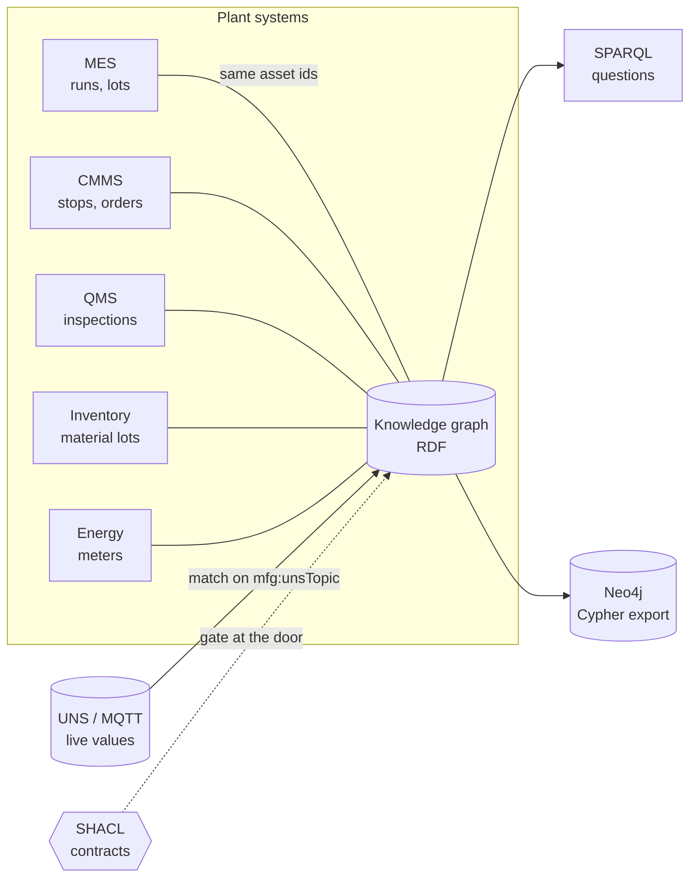
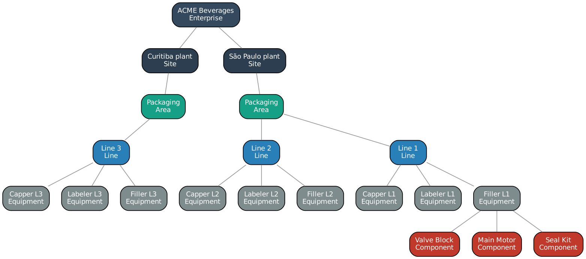
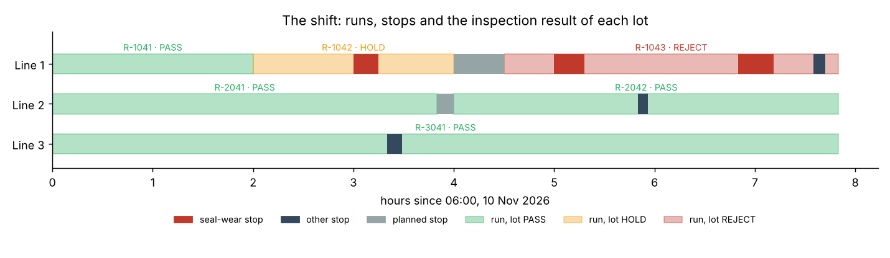
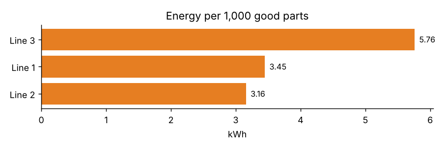
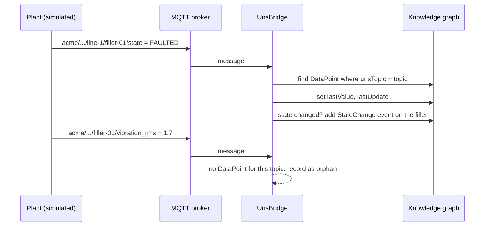
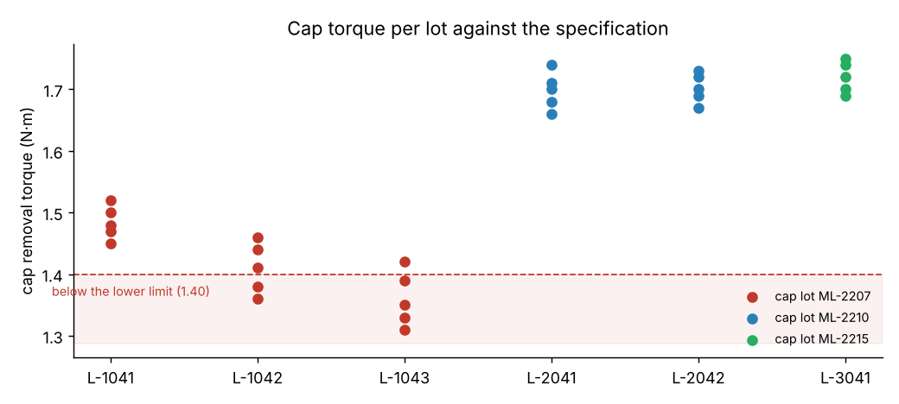
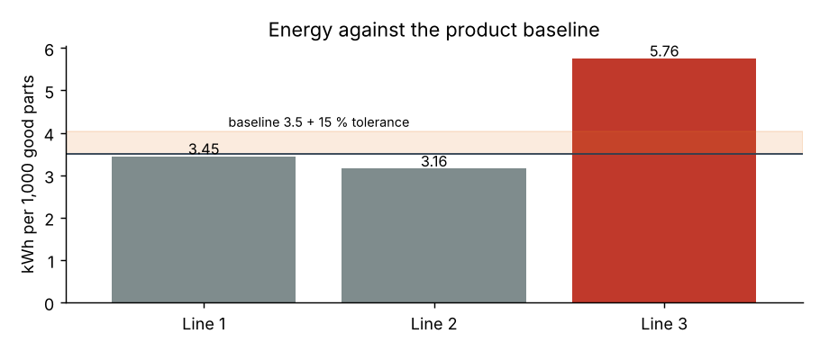

# industrial-ontology-lab

**A runnable semantic layer for a manufacturing plant, written as a study guide.**

An ontology made of a **core** plus **domain extensions**, a knowledge graph of a fictional two-site company, **SHACL data contracts**, cross-domain **SPARQL**, a live **UNS (MQTT) to graph bridge**, and an export to **Neo4j**. Everything is original work, runs on a laptop in minutes, and is covered by tests in CI.

**Version 2** makes the model readable by people and by AI agents: 120 terms, every one with a definition, every class with an example, 15 competency questions that run as tests, and the ontology itself exported into the graph next to the data.

[](https://github.com/MatheusEduGarcia/industrial-ontology-lab/actions/workflows/ci.yml)


> **How to read this page.** Each lesson has the idea, the code that does it, what came out, and what that means. The seven notebooks in [`notebooks/`](notebooks/) follow the same path in Portuguese, with every cell commented and every output kept.

---

## Contents

0. [The problem](#0-the-problem)
1. [The core ontology and the ISA-95 hierarchy](#1-the-core-ontology-and-the-isa-95-hierarchy)
2. [Domain extensions](#2-domain-extensions)
3. [Data contracts with SHACL](#3-data-contracts-with-shacl)
4. [Business questions that cross domains](#4-business-questions-that-cross-domains)
5. [The live UNS bridge and the Neo4j export](#5-the-live-uns-bridge-and-the-neo4j-export)
6. [Version 2: a wider model, driven by questions](#6-version-2-a-wider-model-driven-by-questions)
7. [An ontology that people and AI agents can read](#7-an-ontology-that-people-and-ai-agents-can-read)
8. [How the notebooks teach](#how-the-notebooks-teach)
9. [Run it yourself](#run-it-yourself)

---

## 0. The problem

MES, CMMS, QMS, inventory and energy monitoring each keep their own idea of "the machine". A question that crosses them, such as *"which lots were made while the filler was failing, and which cap lot did they use?"*, turns into a week of spreadsheets.

The fix is three pieces that work together:

| Piece | What it is | Here |
|---|---|---|
| **Ontology** | the vocabulary: classes, relations, rules | [`ontology/`](ontology/) |
| **Knowledge graph** | the plant's facts, written in that vocabulary | [`data/plant.ttl`](data/plant.ttl) |
| **Data contracts** | what a record must contain to be accepted | [`shapes/shapes.ttl`](shapes/shapes.ttl) |



---

## 1. The core ontology and the ISA-95 hierarchy

**Idea.** The core is small on purpose: only what *every* domain needs. Asset identity (`assetId`), containment (`partOf`, transitive), data points with their UNS topic, and events with a time and a place.

```turtle
mfg:partOf a owl:ObjectProperty, owl:TransitiveProperty ;
    rdfs:comment "Containment in the equipment hierarchy. Transitive: a filler partOf line 1 partOf area partOf site." ;
    rdfs:domain mfg:Asset ; rdfs:range mfg:Asset .

mfg:unsTopic a owl:DatatypeProperty ;
    rdfs:comment "Where the live value of this data point is published in the Unified Namespace." ;
    rdfs:domain mfg:DataPoint ; rdfs:range xsd:string .
```

**Result.** The sample plant, drawn from its `partOf` triples ([`lab/figures.py`](lab/figures.py)):



**Why transitivity matters.** Nobody wrote "the seal kit is part of the São Paulo plant". The property path `partOf+` (one or more hops) finds it:

```sparql
SELECT ?asset ?type WHERE {
  ?asset mfg:partOf+ id:acme/sao-paulo ; a ?type .
}
```

That returns **12 assets**: one area, two lines, six machines and three components two levels below a line.

---

## 2. Domain extensions

**Idea.** Production, maintenance, quality, energy and inventory are separate files. Each one *imports* the core and only *adds* terms, so every domain can have its own owner and release cycle without redefining the machine.


**How to read it.** Solid arrows are relations (`domain → range`), dashed arrows are `subClassOf`. Note where everything lands: `ProductionRun`, `Downtime`, `Inspection`, `MaintenanceOrder` and `Consumption` all extend **`Event`**, so they all inherit *when* (`startTime`, `endTime`) and *where* (`occurredOn`). That shared time and place is what lets section 4 cross a stop with a run without a join table.

| Domain | Adds | Hangs on the core through |
|---|---|---|
| production | Product, WorkOrder, Lot, ProductionRun | `ProductionRun ⊂ Event` |
| maintenance | Downtime, FailureMode, MaintenanceOrder, Component | `Downtime ⊂ Event`, `Component ⊂ Asset` |
| quality | Inspection, Finding, DefectType | `Inspection ⊂ Event` |
| energy | EnergyMeter, Consumption | `EnergyMeter ⊂ DataPoint` |
| inventory | Material, MaterialLot | consumed by a `ProductionRun` |

---

## 3. Data contracts with SHACL

**Idea.** The ontology says what things **mean**. SHACL says what a record **must contain** to be accepted. Without contracts the graph fills up with half-records, and the first Pareto shows 40 % of stops "without a reason".

```turtle
shp:DowntimeShape a sh:NodeShape ; sh:targetClass mnt:Downtime ;
    sh:sparql [
        sh:message "An unplanned downtime must have a failure mode (causedBy), otherwise the Pareto is useless." ;
        sh:select """SELECT $this WHERE { $this mnt:planned false .
                     FILTER NOT EXISTS { $this mnt:causedBy ?fm } }""" ] .
```

**Result.** The sample plant passes every contract. Then [`data/broken.ttl`](data/broken.ttl) adds five records a careless integration could send:

| Record | What is wrong | Rule that caught it |
|---|---|---|
| `new-palletizer` | no `assetId`, not part of any line | `minCount`, `class` |
| `new-palletizer/speed` | topic `PLC1.DB10.Speed` is a PLC address, not a UNS path | `sh:pattern` |
| `D-999` | ends before it starts, and has no cause | two `sh:sparql` rules |
| `WO-9999` | no product, target quantity 0 | `minCount`, `minExclusive` |
| `Q-9999` | result `"ok, looks fine"` | `sh:in (PASS HOLD REJECT)` |

**8 violations, 0 false positives.** Notebook 03 also shows the contract used as a gate: a good downtime record is accepted, and the same record without a cause is rejected with the rule's own message.

---

## 4. Business questions that cross domains

The sample data carries a small story. Here is the whole shift on one picture:



Line 1 is the one to look at: the runs that had seal-wear stops (strong red) produced lots that were put on HOLD or rejected. The queries below turn that impression into numbers. All seven live in [`lab/queries.py`](lab/queries.py).

### 4.1 Maintenance × production: where does the time go?

```sparql
SELECT ?line ?mode (COUNT(?d) AS ?stops) (SUM(?minutes) AS ?total_min) WHERE {
  ?d a mnt:Downtime ; mnt:planned false ; mnt:causedBy/rdfs:label ?mode ;
     mfg:occurredOn/mfg:partOf/rdfs:label ?line ; ...
} GROUP BY ?line ?mode
```


`occurredOn/partOf/label` walks from the stop to the machine, from the machine to the line, and from the line to its name in one line of SPARQL. Planned stops (lunch) are left out.

### 4.2 Maintenance × production × quality: lots made during failures

The query links each run to the stops that happened **inside its time window** (`?ds < ?re && ?de > ?rs`), and each lot to its inspection.

| Lot | Result | Leaks | Stops during the run | Failure modes |
|---|---|---:|---:|---|
| L-1041 | 🟢 PASS | 4 | 0 | |
| L-1042 | 🟠 HOLD | 37 | 1 | Seal wear |
| L-1043 | 🔴 REJECT | 61 | 3 | Seal wear, Bottle jam |
| L-2041 | 🟢 PASS | 1 | 0 | |
| L-2042 | 🟢 PASS | 0 | 1 | Bottle jam |
| L-3041 | 🟢 PASS | 2 | 1 | Motor overload |

### 4.3 Inventory × quality: genealogy of a material lot

| Cap lot | Supplier | Product lots | Results |
|---|---|---|---|
| **ML-2207** | Cap Co | L-1041, L-1042, L-1043 (Line 1) | 🟢 🟠 🔴 |
| ML-2210 | Seal Systems | L-2041, L-2042 (Line 2) | 🟢 🟢 |
| ML-2215 | Seal Systems | L-3041 (Line 3) | 🟢 |

### 4.4 The lesson: was it the seal or the cap?

> [!IMPORTANT]
> The graph found **two** explanations for the leaks, and it cannot pick one.
>
> * **Maintenance hypothesis:** leaks grow with seal-wear stops (0 → 1 → 2 stops, 4 → 37 → 61 leaks).
> * **Material hypothesis:** every bad lot used cap lot ML-2207, and no lot with other caps failed.
>
> The two factors are **confounded**: ML-2207 was only used on line 1, which is also the only line with seal wear. No query separates them. What the graph does is put the right question on the table in minutes instead of weeks of meetings between maintenance, quality and purchasing. The next step is an experiment, such as running ML-2207 on line 2.

### 4.5 More questions in the notebook

| Question | Crosses | Answer |
|---|---|---|
| Which component does the top failure mode hit, and was it replaced? | maintenance | Seal wear → Seal Kit, 3 stops, replaced by MO-0077 |
| Where do I subscribe for the live state of every filler? | core × UNS | 3 topics, see section 5 |
| Energy per 1,000 good parts | energy × production | below |



Line 3 spends about **80 % more energy per part** than line 2 for the same product. The meter is attached to the *line* and the parts are counted on the *machine's* runs; the graph rolls one up to the other through `partOf`.

---

## 5. The live UNS bridge and the Neo4j export

**Idea.** The UNS knows the *current value*; the graph knows *what each value is*. One field joins them: `mfg:unsTopic`.



**Result from notebook 05** (8 seconds of simulated traffic):

```
mensagens recebidas      : 160
eventos de estado criados: 7
tópicos órfãos           : ['acme/sao-paulo/packaging/line-1/filler-01/vibration_rms']
```

* Every known topic updated its node in the graph, and each state change became an event linked to the machine, so history lands **in the model** with all its context (line, site, runs, stops).
* `vibration_rms` is an **orphan**: it exists in the UNS but not in the model. That is someone who added a sensor without registering it, and a useful governance metric.

**Neo4j.** [`lab/to_cypher.py`](lab/to_cypher.py) maps typed resources to nodes, literals to properties and object properties to relationships, all with `MERGE` on the IRI so the load is idempotent:

```cypher
MERGE (n:Resource:Downtime {iri: '.../downtime/D-001'}) SET n.planned = false, n.startTime = datetime('2026-11-10T09:00:00+00:00'), ...;
MATCH (a:Resource {iri: '.../downtime/D-001'}), (b:Resource {iri: '.../failure-mode/seal-wear'}) MERGE (a)-[:CAUSED_BY]->(b);
```

The same lots question in Cypher is in [`neo4j/queries.cypher`](neo4j/queries.cypher).

| | RDF + SPARQL | Neo4j + Cypher |
|---|---|---|
| Schema and rules | standard OWL and SHACL | project conventions |
| Identity | global IRIs, easy to merge across systems | local ids |
| Path queries | property paths | visual patterns, very readable |
| App ecosystem | smaller | larger, built-in visualization |

A common split: model and validate in RDF, serve applications from Neo4j.

---

## 6. Version 2: a wider model, driven by questions

**Rule for growing the model: no class without a business question that needs it.** Version 2 adds capabilities, operating states with allowed transitions, preventive plans, spare parts, measurements against specification, non-conformances, an energy baseline, suppliers and stock. Each addition exists because of one of the questions below.

| Module | Classes | Relations | Attributes | New in version 2 |
|---|---:|---:|---:|---|
| core | 14 | 11 | 9 | EquipmentClass, Capability, OperatingState and its transitions, Person, Role |
| production | 6 | 6 | 4 | Shift, Changeover, `requiresCapability` |
| maintenance | 8 | 7 | 5 | Corrective and preventive orders, MaintenancePlan, SparePart |
| quality | 7 | 8 | 7 | Characteristic, Specification, Measurement, NonConformance |
| energy | 4 | 4 | 3 | EnergyCarrier, EnergyBaseline |
| inventory | 5 | 6 | 2 | Supplier, StorageLocation, StockItem |

The full list, with every definition and example, is generated in [`docs/ontology_reference.md`](docs/ontology_reference.md).

### The same investigation, with more evidence

Section 4.4 ended with two hypotheses for the leaks that the data could not separate. The wider model brings three new facts to the same shift:

| New fact | Query | Points to |
|---|---|---|
| The preventive plan for the filler seal kit was **13 days overdue** | `overdue_plans()` | the filler (maintenance) |
| Cap torque is low on **every** lot that used cap lot ML-2207, including L-1041, which had no stop at all | `TORQUE_VS_SPEC` | the cap (material) |
| 13,800 caps of ML-2207 are still in stock, 1,800 of them at the line | `STOCK_TO_QUARANTINE` | what to contain today |



L-1041 is the informative one: it ran with no seal-wear stop and still sits at the bottom of the range. That weakens "it is only the seal". It is still not a verdict, because torque also depends on the line 1 capper and ML-2207 only ran there. More domains in the graph mean more evidence and a cheaper experiment (one pallet of ML-2207 on line 2), not the end of experimenting.

### A model that can distrust the data

The core now defines four harmonized states and the transitions that are possible. A machine in `FAULTED` has to be reset before it runs again, so a reported `FAULTED → RUNNING` is a data problem: a lost message, two internal states mapped to the same text, or polling too slow to see the reset. The bridge records the state left and the state entered, and one query lists what the model says cannot happen.

```sparql
SELECT ?equipment ?from ?to WHERE {
  ?e a mfg:StateChange ; mfg:fromOperatingState ?a ; mfg:toOperatingState ?b ; mfg:occurredOn/rdfs:label ?equipment .
  ?a rdfs:label ?from . ?b rdfs:label ?to .
  FILTER NOT EXISTS { ?a mfg:canTransitionTo ?b }
}
```

And energy now has a criterion instead of an impression: line 3 is 64 % above the product baseline, with a tolerance of 15 %.



---

## 7. An ontology that people and AI agents can read

An AI agent about to query a plant graph has the same problem as an engineer on the first day: it does not know which classes exist, what each one means, or how they connect. Four pieces make the model answer that by itself.

| Piece | What it does | Where |
|---|---|---|
| **Definition and example on every term** | says what belongs in a class without looking at the data | `ontology/*.ttl` |
| **Catalog** | serves the model as text: one term in full, or everything in about 1,700 tokens | [`lab/catalog.py`](lab/catalog.py) |
| **Lint** | fails CI on a term with no definition, a property with no range, or a term used in the data that nobody declared | [`lab/lint.py`](lab/lint.py) |
| **Competency questions** | the business questions the model must answer, each with its query and a check | [`lab/competency.py`](lab/competency.py) |

```text
>>> print(catalog.describe("Downtime"))
mnt:Downtime  (class, module maintenance)
  An interval in which equipment did not run when it was scheduled to.
  Examples: filler-01 stopped 15 minutes for seal wear
  Is a: mfg:Event
  Has:
    mfg:endTime -> dateTime   When the event ended. Absent while the event is still open.
    mfg:occurredOn -> mfg:Asset   The asset the event happened to.
    mfg:performedBy -> mfg:Person   Who carried out the event.
    mfg:startTime -> dateTime   When the event began.
    mnt:causedBy -> mnt:FailureMode   The failure mode behind a stop.
    mnt:planned -> boolean   True for stops that were scheduled, such as lunch. ...
  Is pointed at by:
    mnt:resolves <- mnt:MaintenanceOrder   The stop a maintenance order was raised to fix.
```

Four of those six lines come from `mfg:Event`, not from the maintenance file. Inheritance is resolved for the reader.

### Competency questions

Written before the model, used to decide what goes in, and run as tests afterwards. If a change breaks an answer, CI says which business question was lost.

| # | Question | Modules it crosses | Answer from the sample plant |
|---|---|---|---|
| CQ01 | What exists inside the São Paulo plant, at any depth? | core | 12 assets: 1 area, 2 lines, 6 machines and 3 components |
| CQ02 | Which failure mode cost the most unplanned downtime, and on which line? | maintenance, core | Seal wear on Line 1: 3 stops, 54 min |
| CQ03 | Which component does that failure mode hit, and was it replaced? | maintenance | Seal Kit, replaced by MO-0077 |
| CQ04 | Which lots were made while those stops were happening, and what did inspection decide? | maintenance, production, quality | L-1042 HOLD (1 stops); L-1043 REJECT (3 stops) |
| CQ05 | Which product lots consumed cap lot ML-2207, and how did they fare? | inventory, quality | L-1041 PASS, L-1042 HOLD, L-1043 REJECT |
| CQ06 | Which line uses the most energy per thousand good parts? | energy, production | Line 3: 5.76 kWh per 1,000 |
| CQ07 | Where do I subscribe to read the live state of every filler? | core | 3 topics, for example acme/curitiba/packaging/line-3/filler-01/state |
| CQ08 | On which lines can orange juice 1 l run? | core, production | only Line 3 |
| CQ09 | Was any preventive plan overdue on the day of the shift? | maintenance | PM-SEAL-L1 for the Seal Kit of Filler L1, due 2026-10-28; that component caused 3 stops |
| CQ10 | Which lots have cap torque below specification, and which cap lot did they use? | quality, inventory | L-1042: 2 of 5 samples, cap lot ML-2207; L-1043: 4 of 5 samples, cap lot ML-2207 |
| CQ11 | Which line is outside the energy baseline of the product it made? | energy, production | Line 3: 64 % above the baseline (tolerance 15 %) |
| CQ12 | Where is the remaining stock of material that went into non-conforming lots? | quality, inventory | 12000 of ML-2207 at Warehouse rack A-03; 1800 of ML-2207 at Point of use, line 1 |
| CQ13 | Who performed the maintenance orders and the inspections? | core, maintenance, quality | Ana Lima (Maintenance technician): 1 x Corrective order; Ana Lima (Maintenance technician): 1 x Preventive order; Bruno Reis (Quality inspector): 6 x Inspection |
| CQ14 | Which failure mode seen on the shift hits a component with no spare in stock? | maintenance | Motor overload: Main motor MTR-7 has 0 in stock |
| CQ15 | Did any equipment report a state change the model says is impossible? | core | Filler L1: FAULTED to RUNNING without a reset (1 of 2 changes injected for the test) |

### The ontology inside the graph

`python -m lab.to_cypher ontology` exports the model itself to Neo4j: each class is a node with its definition and examples, each relation is a node linked to where it starts and ends, and each instance points at its class. An application can ask the database what a label means before it queries the instances.

```cypher
MATCH (c:OntologyClass {name: 'Downtime'})-[:SUBCLASS_OF*0..]->(k)<-[:DOMAIN]-(p:OntologyProperty)
RETURN c.definition, p.name, p.definition;
```

No language model is called anywhere in this repository. This is the groundwork: the catalog functions are exactly the tools an agent would be given.

---

## How the notebooks teach

The notebooks are in Portuguese and committed **already executed**, so they read on GitHub without installing anything. Every one has the same structure:

| Block | What it is for |
|---|---|
| **Antes de começar** | who it is for, prerequisites, time, what you will be able to do, where it shows up in a plant, and one analogy |
| **Concept, then experiment** | a short explanation followed by a cell that proves it, with the real output kept |
| **Pare e preveja** | before the key experiments, a question to answer before running the cell |
| **Leitura do resultado** | what the output means, right under it |
| **Erros comuns** | the mistakes people actually make |
| **Teste seu entendimento** | three questions with answers hidden behind a click |
| **Exercícios**, **Glossário**, **Próximo passo** | things to try, the vocabulary, and the link to the next notebook |

| # | Notebook | You learn to |
|---|---|---|
| 01 | [Ontologia central](notebooks/01_ontologia_central.ipynb) | read a triple, tell class from instance, use a transitive property in a query |
| 02 | [Extensões de domínio](notebooks/02_extensoes_de_dominio.ipynb) | explain why each domain imports the core and what events inherit |
| 03 | [Contratos de dados com SHACL](notebooks/03_contratos_de_dados_shacl.ipynb) | read a shape, interpret a validation report, gate records at the door |
| 04 | [Consultas de negócio](notebooks/04_consultas_de_negocio.ipynb) | cross domains by time and asset, and recognize confounded factors |
| 05 | [UNS ao vivo e Neo4j](notebooks/05_uns_ao_vivo_e_neo4j.ipynb) | join live MQTT values to the model and export RDF to a property graph |
| 06 | [O modelo ampliado](notebooks/06_perguntas_do_modelo_ampliado.ipynb) | justify each new class by a question, write "for all" in SPARQL, combine evidence across domains |
| 07 | [Ontologia legível por agentes](notebooks/07_ontologia_legivel_por_agentes.ipynb) | use the catalog, the lint and competency questions to keep a model readable by people and AI agents |

The didactic layer lives in [`tools/didatico_conteudo.py`](tools/didatico_conteudo.py) and is applied with `python tools/didatico.py tools/didatico_conteudo.py .`, so it survives re-running a notebook.

---

## Run it yourself

```bash
pip install -r requirements.txt
docker compose up -d          # mosquitto, for notebooks 05 and 06 and the bridge tests
pytest -q                     # 14 tests
python -m lab.lint            # house rules for the ontology
python -m lab.competency      # the 15 competency questions, also writes docs/competency_questions.md
python -m lab.catalog         # regenerate docs/ontology_reference.md and ontology/catalog.json
jupyter lab notebooks/
python -m lab.figures         # regenerate docs/img (needs Graphviz: apt install graphviz)
```

Neo4j (optional): `docker compose -f neo4j/docker-compose.yml up -d`, then load `neo4j/plant.cypher` and after it `neo4j/ontology.cypher` with `cypher-shell`, or paste them at http://localhost:7474. The Cypher is generated and its structure is tested, but it is not loaded into a live Neo4j in CI.

### Layout

| Path | What |
|---|---|
| `ontology/` | `core.ttl` and five domain extensions (Turtle, OWL) |
| `data/` | `plant.ttl` (generated by `python -m lab.sample_data`), `broken.ttl` and `broken_v2.ttl` |
| `shapes/` | SHACL contracts |
| `lab/` | queries, validator, UNS bridge, Cypher export, figures, catalog, lint, competency questions |
| `notebooks/` | 01 core · 02 extensions · 03 SHACL · 04 questions · 05 UNS and Neo4j · 06 wider model · 07 agent-readable |
| `docs/` | generated ontology reference and competency questions, and the figures on this page |
| `tools/` | notebook generator and the didactic layer |

### Related

* [iiot-protocols-examples](https://github.com/MatheusEduGarcia/iiot-protocols-examples): Modbus, OPC UA, MQTT, Sparkplug B and UNS examples that feed a layer like this one.

MIT License.
