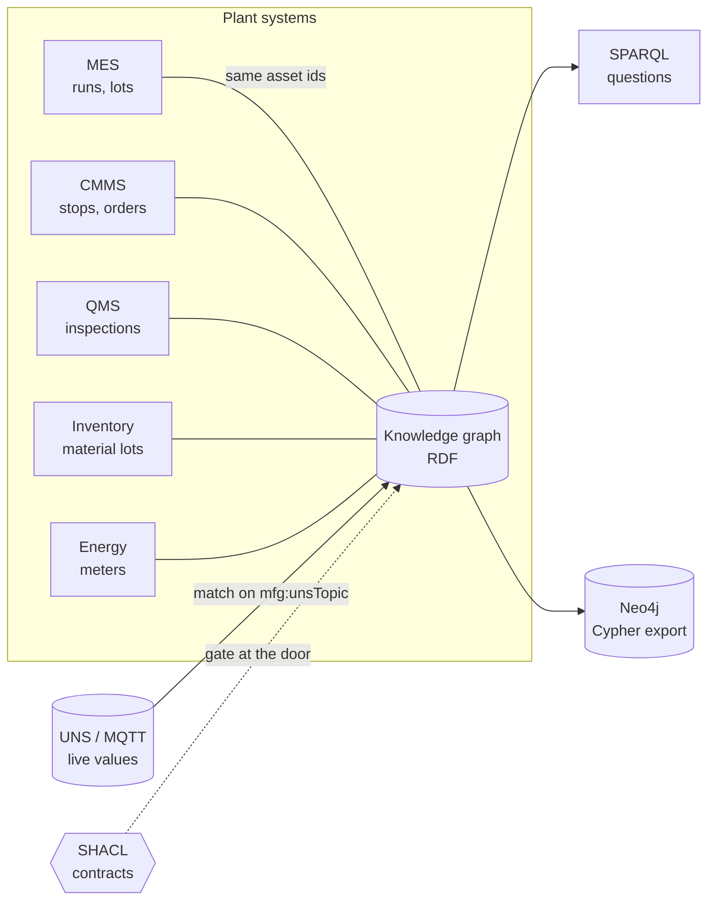
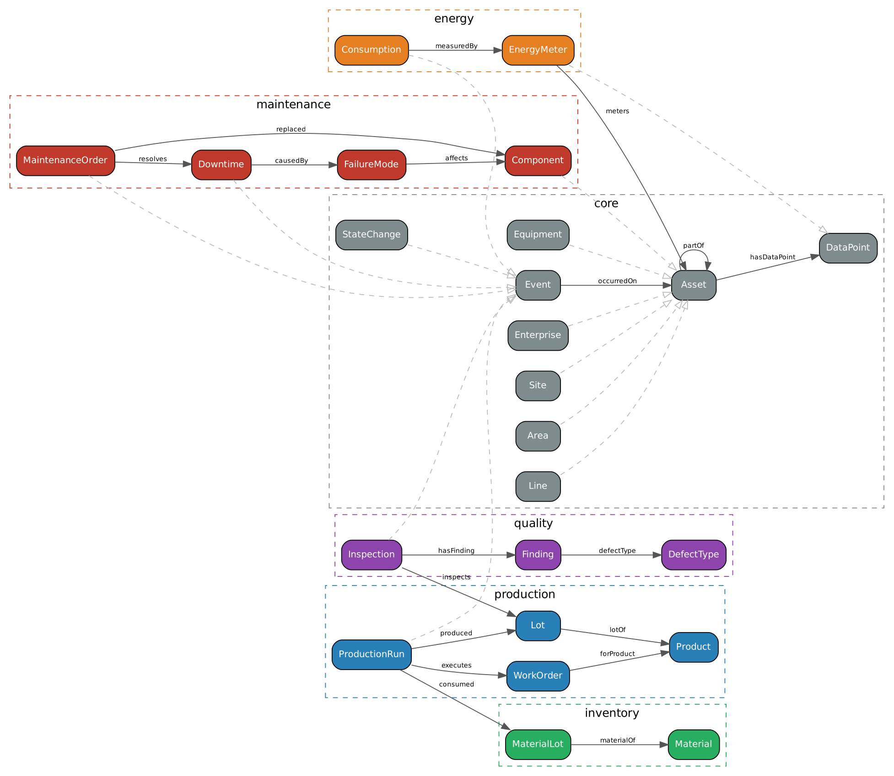
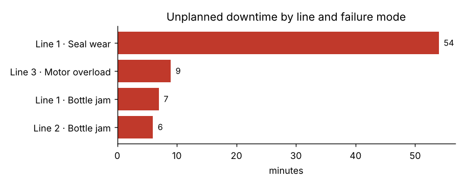
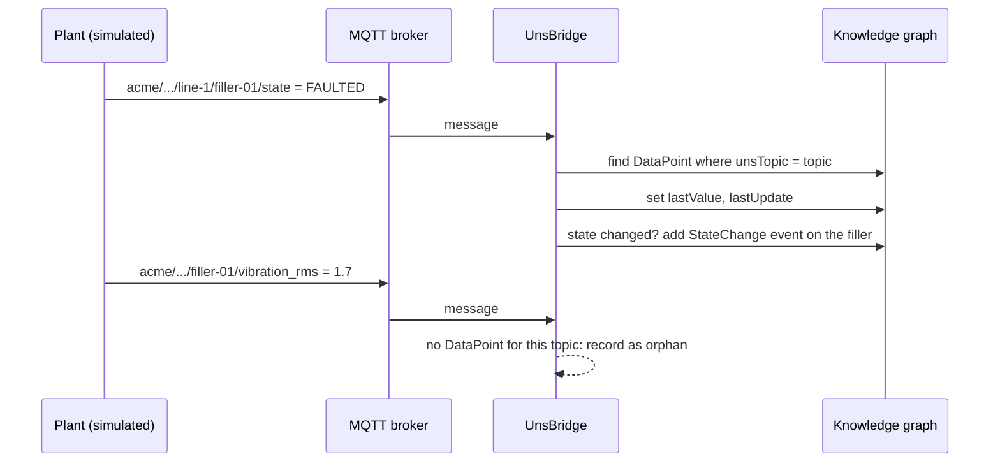

# industrial-ontology-lab

**A runnable semantic layer for a manufacturing plant, written as a study guide.**

An ontology made of a **core** plus **domain extensions**, a knowledge graph of a fictional two-site company, **SHACL data contracts**, cross-domain **SPARQL**, a live **UNS (MQTT) to graph bridge**, and an export to **Neo4j**. Everything is original work, runs on a laptop in minutes, and is covered by tests in CI.

[](https://github.com/MatheusEduGarcia/industrial-ontology-lab/actions/workflows/ci.yml)


> **How to read this page.** Each lesson has the idea, the code that does it, what came out, and what that means. The five notebooks in [`notebooks/`](notebooks/) follow the same path in Portuguese, with every cell commented and every output kept.

---

## Contents

0. [The problem](#0-the-problem)
1. [The core ontology and the ISA-95 hierarchy](#1-the-core-ontology-and-the-isa-95-hierarchy)
2. [Domain extensions](#2-domain-extensions)
3. [Data contracts with SHACL](#3-data-contracts-with-shacl)
4. [Business questions that cross domains](#4-business-questions-that-cross-domains)
5. [The live UNS bridge and the Neo4j export](#5-the-live-uns-bridge-and-the-neo4j-export)
6. [Run it yourself](#6-run-it-yourself)

---

## 0. The problem

MES, CMMS, QMS, inventory and energy monitoring each keep their own idea of "the machine". A question that crosses them, such as *"which lots were made while the filler was failing, and which cap lot did they use?"*, turns into a week of spreadsheets.

The fix is three pieces that work together:

| Piece | What it is | Here |
|---|---|---|
| **Ontology** | the vocabulary: classes, relations, rules | [`ontology/`](ontology/) |
| **Knowledge graph** | the plant's facts, written in that vocabulary | [`data/plant.ttl`](data/plant.ttl) |
| **Data contracts** | what a record must contain to be accepted | [`shapes/shapes.ttl`](shapes/shapes.ttl) |



---

## 1. The core ontology and the ISA-95 hierarchy

**Idea.** The core is small on purpose: only what *every* domain needs. Asset identity (`assetId`), containment (`partOf`, transitive), data points with their UNS topic, and events with a time and a place.

```turtle
mfg:partOf a owl:ObjectProperty, owl:TransitiveProperty ;
    rdfs:comment "Containment in the equipment hierarchy. Transitive: a filler partOf line 1 partOf area partOf site." ;
    rdfs:domain mfg:Asset ; rdfs:range mfg:Asset .

mfg:unsTopic a owl:DatatypeProperty ;
    rdfs:comment "Where the live value of this data point is published in the Unified Namespace." ;
    rdfs:domain mfg:DataPoint ; rdfs:range xsd:string .
```

**Result.** The sample plant, drawn from its `partOf` triples ([`lab/figures.py`](lab/figures.py)):


**Why transitivity matters.** Nobody wrote "the seal kit is part of the São Paulo plant". The property path `partOf+` (one or more hops) finds it:

```sparql
SELECT ?asset ?type WHERE {
  ?asset mfg:partOf+ id:acme/sao-paulo ; a ?type .
}
```

That returns **12 assets**: one area, two lines, six machines and three components two levels below a line.

---

## 2. Domain extensions

**Idea.** Production, maintenance, quality, energy and inventory are separate files. Each one *imports* the core and only *adds* terms, so every domain can have its own owner and release cycle without redefining the machine.



**How to read it.** Solid arrows are relations (`domain → range`), dashed arrows are `subClassOf`. Note where everything lands: `ProductionRun`, `Downtime`, `Inspection`, `MaintenanceOrder` and `Consumption` all extend **`Event`**, so they all inherit *when* (`startTime`, `endTime`) and *where* (`occurredOn`). That shared time and place is what lets section 4 cross a stop with a run without a join table.

| Domain | Adds | Hangs on the core through |
|---|---|---|
| production | Product, WorkOrder, Lot, ProductionRun | `ProductionRun ⊂ Event` |
| maintenance | Downtime, FailureMode, MaintenanceOrder, Component | `Downtime ⊂ Event`, `Component ⊂ Asset` |
| quality | Inspection, Finding, DefectType | `Inspection ⊂ Event` |
| energy | EnergyMeter, Consumption | `EnergyMeter ⊂ DataPoint` |
| inventory | Material, MaterialLot | consumed by a `ProductionRun` |

---

## 3. Data contracts with SHACL

**Idea.** The ontology says what things **mean**. SHACL says what a record **must contain** to be accepted. Without contracts the graph fills up with half-records, and the first Pareto shows 40 % of stops "without a reason".

```turtle
shp:DowntimeShape a sh:NodeShape ; sh:targetClass mnt:Downtime ;
    sh:sparql [
        sh:message "An unplanned downtime must have a failure mode (causedBy), otherwise the Pareto is useless." ;
        sh:select """SELECT $this WHERE { $this mnt:planned false .
                     FILTER NOT EXISTS { $this mnt:causedBy ?fm } }""" ] .
```

**Result.** The sample plant passes every contract. Then [`data/broken.ttl`](data/broken.ttl) adds five records a careless integration could send:

| Record | What is wrong | Rule that caught it |
|---|---|---|
| `new-palletizer` | no `assetId`, not part of any line | `minCount`, `class` |
| `new-palletizer/speed` | topic `PLC1.DB10.Speed` is a PLC address, not a UNS path | `sh:pattern` |
| `D-999` | ends before it starts, and has no cause | two `sh:sparql` rules |
| `WO-9999` | no product, target quantity 0 | `minCount`, `minExclusive` |
| `Q-9999` | result `"ok, looks fine"` | `sh:in (PASS HOLD REJECT)` |

**8 violations, 0 false positives.** Notebook 03 also shows the contract used as a gate: a good downtime record is accepted, and the same record without a cause is rejected with the rule's own message.

---

## 4. Business questions that cross domains

The sample data carries a small story. Here is the whole shift on one picture:


Line 1 is the one to look at: the runs that had seal-wear stops (strong red) produced lots that were put on HOLD or rejected. The queries below turn that impression into numbers. All seven live in [`lab/queries.py`](lab/queries.py).

### 4.1 Maintenance × production: where does the time go?

```sparql
SELECT ?line ?mode (COUNT(?d) AS ?stops) (SUM(?minutes) AS ?total_min) WHERE {
  ?d a mnt:Downtime ; mnt:planned false ; mnt:causedBy/rdfs:label ?mode ;
     mfg:occurredOn/mfg:partOf/rdfs:label ?line ; ...
} GROUP BY ?line ?mode
```



`occurredOn/partOf/label` walks from the stop to the machine, from the machine to the line, and from the line to its name in one line of SPARQL. Planned stops (lunch) are left out.

### 4.2 Maintenance × production × quality: lots made during failures

The query links each run to the stops that happened **inside its time window** (`?ds < ?re && ?de > ?rs`), and each lot to its inspection.

| Lot | Result | Leaks | Stops during the run | Failure modes |
|---|---|---:|---:|---|
| L-1041 | 🟢 PASS | 4 | 0 | |
| L-1042 | 🟠 HOLD | 37 | 1 | Seal wear |
| L-1043 | 🔴 REJECT | 61 | 3 | Seal wear, Bottle jam |
| L-2041 | 🟢 PASS | 1 | 0 | |
| L-2042 | 🟢 PASS | 0 | 1 | Bottle jam |
| L-3041 | 🟢 PASS | 2 | 1 | Motor overload |

### 4.3 Inventory × quality: genealogy of a material lot

| Cap lot | Supplier | Product lots | Results |
|---|---|---|---|
| **ML-2207** | Cap Co | L-1041, L-1042, L-1043 (Line 1) | 🟢 🟠 🔴 |
| ML-2210 | Seal Systems | L-2041, L-2042 (Line 2) | 🟢 🟢 |
| ML-2215 | Seal Systems | L-3041 (Line 3) | 🟢 |

### 4.4 The lesson: was it the seal or the cap?

> [!IMPORTANT]
> The graph found **two** explanations for the leaks, and it cannot pick one.
>
> * **Maintenance hypothesis:** leaks grow with seal-wear stops (0 → 1 → 2 stops, 4 → 37 → 61 leaks).
> * **Material hypothesis:** every bad lot used cap lot ML-2207, and no lot with other caps failed.
>
> The two factors are **confounded**: ML-2207 was only used on line 1, which is also the only line with seal wear. No query separates them. What the graph does is put the right question on the table in minutes instead of weeks of meetings between maintenance, quality and purchasing. The next step is an experiment, such as running ML-2207 on line 2.

### 4.5 More questions in the notebook

| Question | Crosses | Answer |
|---|---|---|
| Which component does the top failure mode hit, and was it replaced? | maintenance | Seal wear → Seal Kit, 3 stops, replaced by MO-0077 |
| Where do I subscribe for the live state of every filler? | core × UNS | 3 topics, see section 5 |
| Energy per 1,000 good parts | energy × production | below |


Line 3 spends about **80 % more energy per part** than line 2 for the same product. The meter is attached to the *line* and the parts are counted on the *machine's* runs; the graph rolls one up to the other through `partOf`.

---

## 5. The live UNS bridge and the Neo4j export

**Idea.** The UNS knows the *current value*; the graph knows *what each value is*. One field joins them: `mfg:unsTopic`.



**Result from notebook 05** (8 seconds of simulated traffic):

```
mensagens recebidas      : 160
eventos de estado criados: 7
tópicos órfãos           : ['acme/sao-paulo/packaging/line-1/filler-01/vibration_rms']
```

* Every known topic updated its node in the graph, and each state change became an event linked to the machine, so history lands **in the model** with all its context (line, site, runs, stops).
* `vibration_rms` is an **orphan**: it exists in the UNS but not in the model. That is someone who added a sensor without registering it, and a useful governance metric.

**Neo4j.** [`lab/to_cypher.py`](lab/to_cypher.py) maps typed resources to nodes, literals to properties and object properties to relationships, all with `MERGE` on the IRI so the load is idempotent:

```cypher
MERGE (n:Resource:Downtime {iri: '.../downtime/D-001'}) SET n.planned = false, n.startTime = datetime('2026-11-10T09:00:00+00:00'), ...;
MATCH (a:Resource {iri: '.../downtime/D-001'}), (b:Resource {iri: '.../failure-mode/seal-wear'}) MERGE (a)-[:CAUSED_BY]->(b);
```

The same lots question in Cypher is in [`neo4j/queries.cypher`](neo4j/queries.cypher).

| | RDF + SPARQL | Neo4j + Cypher |
|---|---|---|
| Schema and rules | standard OWL and SHACL | project conventions |
| Identity | global IRIs, easy to merge across systems | local ids |
| Path queries | property paths | visual patterns, very readable |
| App ecosystem | smaller | larger, built-in visualization |

A common split: model and validate in RDF, serve applications from Neo4j.

---

## 6. Run it yourself

```bash
pip install -r requirements.txt
docker compose up -d          # mosquitto, only for notebook 05 and the bridge test
pytest -q                     # 8 tests
jupyter lab notebooks/
python -m lab.figures         # regenerate docs/img (needs Graphviz: apt install graphviz)
```

Neo4j (optional): `docker compose -f neo4j/docker-compose.yml up -d`, then load `neo4j/plant.cypher` with `cypher-shell` or paste it at http://localhost:7474. The Cypher is generated and its structure is tested, but it is not loaded into a live Neo4j in CI.

### Layout

| Path | What |
|---|---|
| `ontology/` | `core.ttl` and five domain extensions (Turtle, OWL) |
| `data/` | `plant.ttl` (generated by `python -m lab.sample_data`) and `broken.ttl` |
| `shapes/` | SHACL contracts |
| `lab/` | queries, validator, UNS bridge, Cypher export, figures |
| `notebooks/` | 01 core · 02 extensions · 03 SHACL · 04 questions · 05 UNS and Neo4j |
| `docs/img/` | the figures on this page |

### Related

* [iiot-protocols-examples](https://github.com/MatheusEduGarcia/iiot-protocols-examples): Modbus, OPC UA, MQTT, Sparkplug B and UNS examples that feed a layer like this one.

MIT License.
